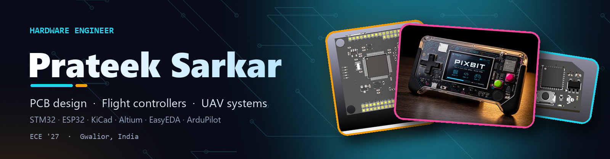

<!-- Prateek Sarkar · GitHub profile README -->

### About

I'm an Electronics & Communication Engineering student (2023 – 2027) who designs hardware that flies. I take boards from schematic and layout through fabrication, bring-up and field testing: flight controllers, UAV avionics, RF receivers, power systems and development boards.

I've worked on UAV hardware at **IIT Roorkee** and **Karman Drones**, collaborated with the **Border Security Force** on UAV and robotics systems, and trained **200+ students** in robotics and embedded systems.

---

### Featured projects

<table>
<tr>
<td width="50%"></td>
<td width="50%"></td>
</tr>
<tr>
<td><b><a href="https://github.com/Prateek-elec/PIXBIT">PIXBIT</a></b> · Open-source ESP32 handheld console for STEM learning</td>
<td><b><a href="https://github.com/Prateek-elec/custom-flight-controller-pcb">STM32F405 Flight Controller</a></b> · IMU, baro, OSD, blackbox, dual BECs</td>
</tr>
<tr>
<td width="50%"></td>
<td width="50%"></td>
</tr>
<tr>
<td><b><a href="https://github.com/Prateek-elec/esp32-drone-flight-controller">ESP32 Micro-Drone</a></b> · The PCB is the airframe</td>
<td><b><a href="https://github.com/Prateek-elec/elrs-receiver-pcb">ExpressLRS Receiver</a></b> · ESP8285 + SX1280, 2.4 GHz</td>
</tr>
<tr>
<td width="50%"></td>
<td width="50%"></td>
</tr>
<tr>
<td><b><a href="https://github.com/Prateek-elec/rc-plane-speedybee-wing405">ArduPilot Plane</a></b> · Scratch-built, with real params and flight log</td>
<td><b><a href="https://github.com/Prateek-elec/pcbly-toolkit">PCBly</a></b> · Desktop PCB calculator (Python)</td>
</tr>
<tr>
<td width="50%"></td>
<td width="50%"></td>
</tr>
<tr>
<td><b><a href="https://github.com/Prateek-elec/ardupilot-flight-test-lab">ArduPilot Flight Test Lab</a></b> · Flight log in, tuned drone out (MATLAB)</td>
<td><b><a href="https://github.com/Prateek-elec/matlab-ece-simulations">MATLAB ECE Simulations</a></b> · Diode physics course and 3D RF ray tracer</td>
</tr>
</table>

<b>More projects</b>

 

| Project | Description |
|---|---|
| [ESP32-C3 Battery Dev Board](https://github.com/Prateek-elec/esp-devboard-prateek) | USB-C, LiPo charging, 3.3 V rail, GPIO breakout. Gerbers included |
| [Line & Maze Solver PCB](https://github.com/Prateek-elec/line-maze-solver-bot-pcb) | Arduino Nano + TB6612FNG carrier for competition robots |
| [Gesture-Controlled Robot](https://github.com/Prateek-elec/hand-gesture-controlled-robot-espnow) | MPU6050 hand unit driving a robot over ESP-NOW |

### Currently building

| | Status |
|---|---|
| **STM32H743 flight controller:** dual IMU, OSD, CAN, microSD | Boards fabricated and assembled, bring-up in progress |
| **DroneCAN RTK GPS module:** RTK GNSS + RM3100 compass | 4-layer layout complete |
| **4-in-1 60 A ESC:** AT32F421, AM32 firmware | Schematic review (V2) |

---

### Experience

| Organisation | Role | Focus |
|---|---|---|
| **IIT Roorkee** | Electronics Engineer Intern | Multilayer PCBs, signal integrity, STM32/ESP32 integration, MAVLink, flight-controller and avionics hardware from schematic to system test |
| **Karman Drones** | UAV Systems Engineer Intern | Surveillance and payload UAVs, FPV and optical-fibre-controlled systems, flight-time optimisation |
| **Border Security Force** | Hardware Collaborator | UAV and robotics systems for national-level deployment |
| **Saveraama Pvt. Ltd.** | Robotics Workshop Trainer | Arduino, line-followers, gesture-controlled robots and automation for 200+ students |

### Recognition

- Acknowledged by **Shri Amit Shah**, Hon'ble Home Minister of India, for technical contributions
- **₹1,00,000** award from **DG Daljit Singh Chaudhary, BSF**, for robotics and technical innovation
- **₹1,00,000** award from **ADG Dr. Shamsher Singh, BSF Academy**, for advanced technical projects

---

### Skills

| Area | Tools and technologies |
|---|---|
| **PCB design** |    · 2- and 4-layer, impedance control, power integrity, DFM |
| **Embedded** |        |
| **UAV systems** |    · flight controllers, ESCs, GNSS / RTK, telemetry and RF links |
| **Interfaces** | UART · SPI · I²C · CAN / DroneCAN · USB · RS-232 |
| **Power** | Buck · boost · LDO · LiPo charging · multi-rail BECs |
| **Lab** | Oscilloscope · logic analyzer · bench supply · SMD rework |

### GitHub activity

---

**Building something that flies? Let's talk.**

